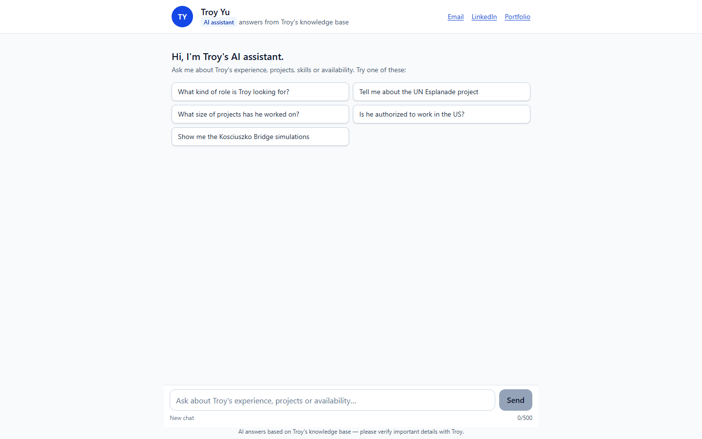
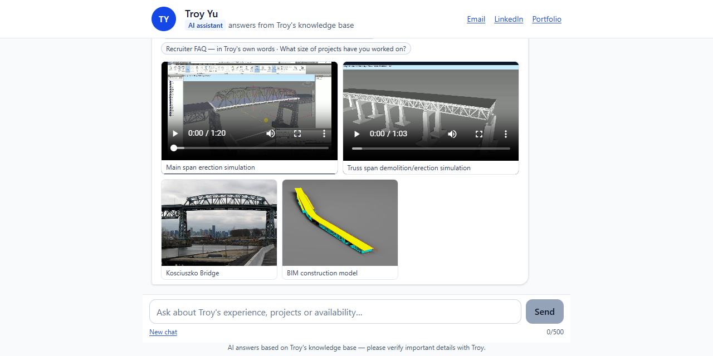

# Ask Troy's AI

**Ask Troy's AI** is a free chat assistant on Troy Yu's portfolio website. Recruiters and visitors type a
question, such as "What was Troy's role on the UN Esplanade?", and get a short answer about Troy's experience,
projects and availability, with links to the projects it is based on.

**Try it:** https://troyyu527.github.io/MyAIPersona/ — or click **Ask my AI** on [Troy's portfolio](https://troyyu527.github.io/ReactWebsite).





## How it works

```
question ──► Cloudflare Worker ──► search the knowledge base ──► prompt with the best passages ──► LLM ──► streamed answer
             (rate limit, checks)   (bge-base embeddings,          (role · rules · context)          (Workers AI,
                                     Cloudflare Vectorize)                                            Llama 3.3 70B)
```

- **Knowledge base** — short passages about Troy's career, written and checked by Troy. They are stored in a
  private Cloudflare Vectorize index and are never part of this repository.
- **Search** — each question is embedded with `bge-base-en-v1.5` and matched against the passages; a follow-up
  such as "How big was it?" is first rewritten into a complete question using the conversation.
- **Answer** — the best passages and a set of rules (career topics only, never invent facts, say so when the
  knowledge base doesn't cover a question) go to the model, and the answer streams into the chat with links,
  pictures and videos of the projects it used.
- It is an AI assistant, not Troy himself. Please confirm important details with Troy directly.

## Privacy and limits

- Questions are answered by Cloudflare Workers AI. The app keeps no conversations: the browser holds the chat
  history and sends only the last few turns with each question.
- To keep the free allowance fair, each visitor (identified by a hashed IP address) can ask a limited number of
  questions per hour.

## Built with

| Part | Technology |
|------|------------|
| Web page | React 18, Vite, TypeScript, Tailwind CSS — hosted on GitHub Pages |
| API | One Cloudflare Worker (TypeScript), Server-Sent Events for streaming |
| AI | Cloudflare Workers AI (`llama-3.3-70b-instruct`, `bge-base-en-v1.5`), LangChain.js |
| Vector store | Cloudflare Vectorize |

## Build from source

Node.js 24+ is needed.

```
npm install
npm run dev        # web page
npm run dev:api    # API (Cloudflare Worker, local)
npm run build      # type check + production build
```

The knowledge base is private and not part of this repository; your own copy needs your own passages, loaded
with `npm run ingest`.
